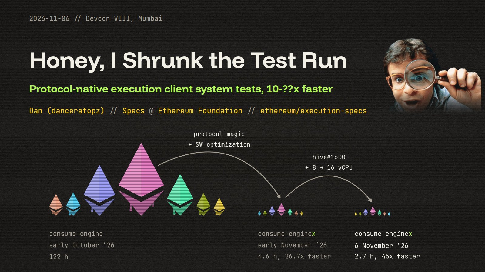

# Honey, I Shrunk the Test Run

Protocol-native execution client system tests, 10-??x faster. Devcon 8, Mumbai, 6 November 2026, by Dan ([danceratopz](https://github.com/danceratopz)).

- **Recording:** [YouTube](https://www.youtube.com/watch?v=JAXXol5mALU)
- **Slides:** [danceratopz.github.io/devcon-8-test-talk](https://danceratopz.github.io/devcon-8-test-talk/) (arrow keys/tap to move, `F` for full screen, `#N` for slide N)

More:

- Talk page: [app.devcon.org](https://app.devcon.org/schedule/honey-i-shrunk-the-test-run-protocol-native-execution-client-system-tests-10-faster)
- Run the tests: [steel.ethereum.foundation/docs/execution-specs/running_tests](https://steel.ethereum.foundation/docs/execution-specs/running_tests/)
- Data: [hive.ethpandaops.io](https://hive.ethpandaops.io/#/group/mainnet)

`site/` is published to GitHub Pages on every push to `main`.

Lamborghini photo: [Alexander-93, Wikimedia Commons](https://commons.wikimedia.org/wiki/File:Lamborghini_Aventador_LP750-4_SV_IMG_9103_(cropped).jpg), CC BY-SA 4.0, cropped. Fonts: SIL Open Font License, see `site/fonts/`.
